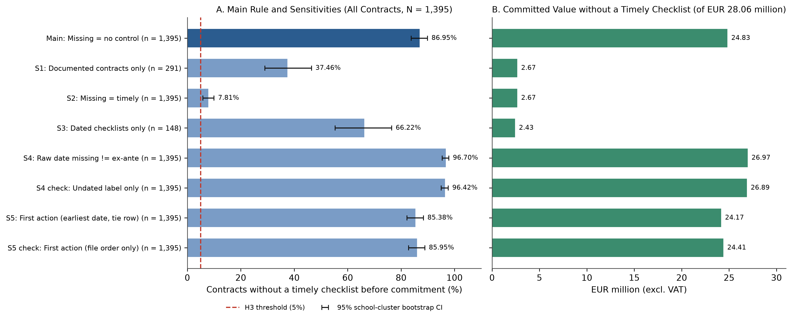
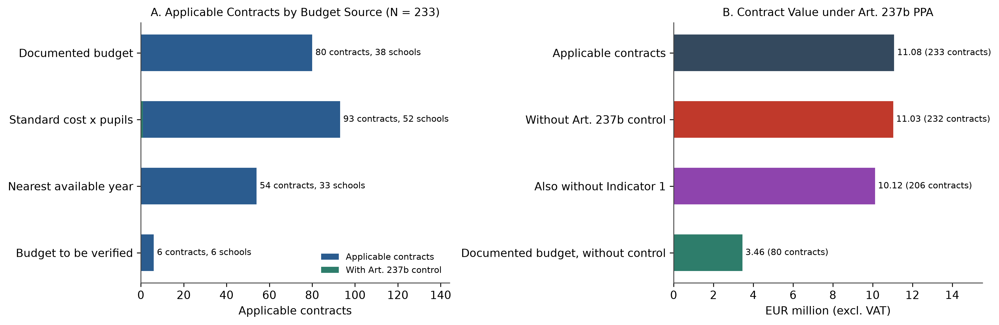
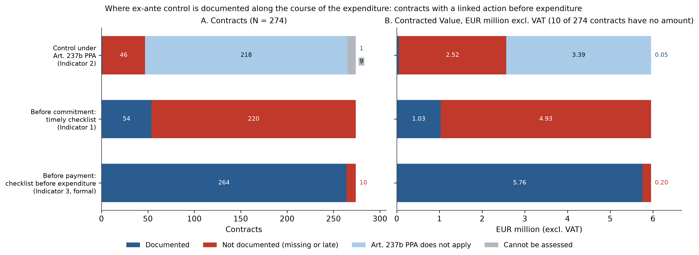
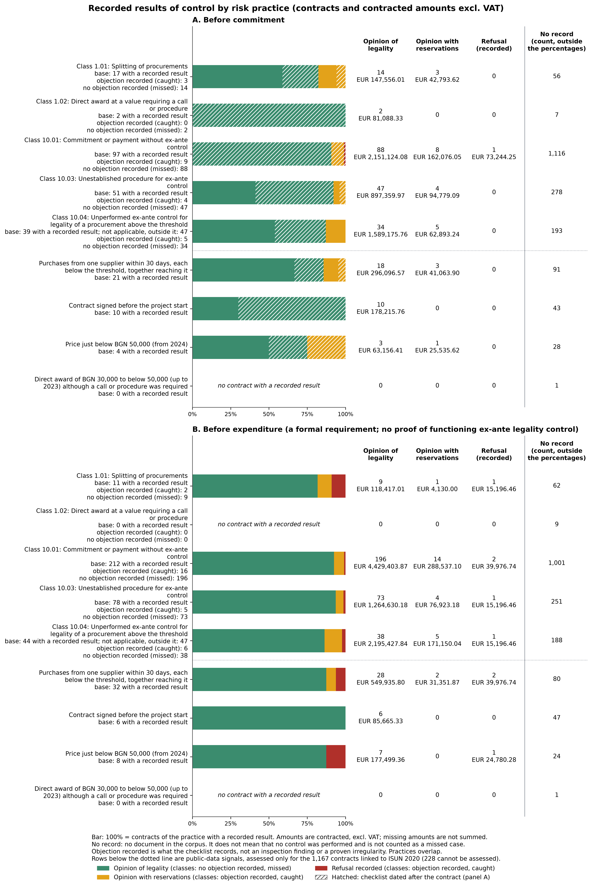
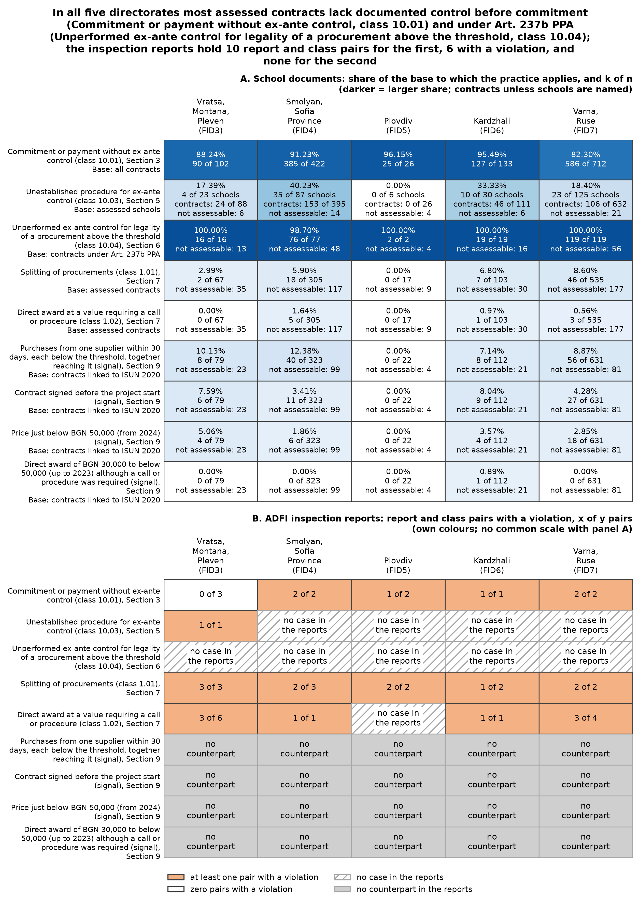

# Ex-Ante Control According to the Documents Obtained under the Access to Public Information Act: Procedure BG-RRP-1.015 "School STEM Environment"

*Documented ex-ante control of legality in the files that 322 schools provided under the Access to Public Information Act on the contracts under procedure BG-RRP-1.015 "School STEM Environment" of the National Recovery and Resilience Plan*

**An indicator is not a proven violation.** The study describes documented control, not the legality of the contracts and not the conduct of persons. School identifiers are pseudonymized in the tables in `data/`; the names and EIK/Bulstat of contractors are kept as public procurement data. No school, municipality or person is accused of anything.

## Objective

The study answers one question: how much of the public funds contracted by the schools of the corpus under BG-RRP-1.015 was committed, and how much was submitted for payment, without documented ex-ante control of legality; does the documented control act as a preventive barrier or as a formality; and which risk practices does it catch and miss?

It measures three indicators in the files obtained under the Access to Public Information Act:

1. **Indicator 1:** documented control before commitment, that is, before the contract is concluded, measured by class 10.01 (*Commitment or payment without ex-ante control*).
2. **Indicator 2:** control under Art. 237b of the Public Procurement Act (PPA), where its condition is met, measured by class 10.04 (*Unperformed ex-ante control for legality of a procurement above the threshold*).
3. **Indicator 3:** the checklist before expenditure, a formal requirement of the Managing Authority for recognition of the expenditure. It is not a measure of documented ex-ante control.

**Hypothesis H3.** Confirmed for a specification only if both lower bounds, of the Wilson interval and of the school-cluster bootstrap, exceed 5%. The share measured is the share of contracts with a control gap before commitment (class 10.01, *Commitment or payment without ex-ante control*). The rule was fixed in Section 1 before the data were loaded.

## Main results

Amounts are contracted amounts in EUR excl. VAT, not amounts paid, damage or loss. The sums are lower bounds, because contracts without an amount are counted separately.

| Question | Result |
|---|---|
| Coverage | 278 of 322 schools have a contract in the corpus; 1,395 contracts, of which 1,233 priced with EUR 28,062,137.01 contracted, and 162 without a documented amount |
| H3 (Indicator 1) | **Confirmed.** 1,213 of the 1,395 contracts (86.95%) lack documented control before commitment; lower bounds 85.08% (Wilson) and 83.77% (bootstrap), above 5% in every specification recorded in Section 3; EUR 24,831,164.29 of the priced value (88.49%) |
| Indicator 2 (Art. 237b PPA) | Documented control for 1 of the 233 applicable contracts; the 232 without it carry EUR 11,033,935.84, 39.32% of the contracted value of all contracts |
| Indicator 3 (before expenditure) | 212 of the 264 contracts with a checklist before expenditure (80.30%; EUR 4,757,917.71) had no timely documented control before commitment |
| Control environment | The last linked checklist is formal for 135 of the 291 contracts with a checklist before commitment (46.39%) and for 206 of the 274 with an action before expenditure (75.18%); 12 of the 2,492 control actions record a refusal (0.48%); contracts of 72 of 271 schools with control actions and without documented rules carry 24.05% of the contracted value |
| Caught and missed | The corpus records the control as having caught at most 4.11% of the contracts to which a class applies; no result is recorded for 76.29% to 100.00% of them; under the rule of Section 1 the control caught 0 of the 73 contracts of class 1.01 (*Splitting of procurements*) and 0 of the 9 of class 1.02 (*Direct award at a value requiring a call or procedure*) |
| Systemic gaps (Section 10) | In each of the five directorates documented control before commitment is missing for at least 82.30% of the contracts, and control under Art. 237b PPA for at least 98.70% of the applicable contracts |

<p align="center"></p>
<p align="center"><b>Control before commitment: main rule and sensitivities of H3, and committed value without a timely checklist (Section 3)</b></p>

<p align="center"></p>
<p align="center"><b>Control under Art. 237b PPA: applicable contracts by budget source and contract value (Section 6)</b></p>

<p align="center"></p>
<p align="center"><b>Where ex-ante control is documented along the course of the expenditure: contracts with a linked action before expenditure (Section 8)</b></p>

<p align="center"></p>
<p align="center"><b>Recorded results of control by risk practice (contracts and contracted amounts excl. VAT) (Section 9)</b></p>

<p align="center"></p>
<p align="center"><b>In all five ADFI directorates most assessed contracts lack documented control before commitment (class 10.01, <i>Commitment or payment without ex-ante control</i>) and under Art. 237b PPA (class 10.04, <i>Unperformed ex-ante control for legality of a procurement above the threshold</i>); the inspection reports hold 10 report and class pairs for the first, 6 with a violation, and none for the second (Section 10)</b></p>

## Conclusions

**1. Public funds were committed without documented control before commitment.** This applies to EUR 24,831,164.29 of the EUR 28,062,137.01 contracted in priced contracts (88.49%) and to 1,213 of the 1,395 contracts (86.95%); the 162 contracts without a documented amount are counted in the contracts only (Section 3).

**2. Control under Art. 237b PPA is almost absent for procurements of weight for the budget.** It is documented for 1 of the 233 applicable contracts, and the 232 contracts without it carry 39.32% of the contracted value of all contracts (EUR 11,033,935.84). The guidelines under Art. 237b(5) PPA place this control before the decision on the award or termination (Ministry of Finance, 2023), and the Act requires the report within 10 days of the receipt of the report of the evaluation committee (Bulgaria, 2016a); these are requirements of the norm, and the data contain no date of the decision, so the period is not measured. The gap is present in 121 of the 122 schools with an applicable contract and in 38 of 38 schools with a documented budget (Section 6).

**3. Commitments without prior control were submitted for payment.** Of the 264 contracts with a checklist before expenditure, 212 (80.30%; EUR 4,757,917.71, 82.65% of the EUR 5,756,535.02 contracted in them) had no timely documented control before commitment. The amounts are contracted, not paid; the sequence protocol, invoice, checklist, payment order is confirmed for 11 of 1,530 payment records (Section 8).

**4. The documented control is a formality more than a barrier, and more so before expenditure than before commitment.** The last linked checklist is formal for 135 of the 291 contracts with a checklist before commitment (46.39%) and for 206 of the 274 contracts with an action before expenditure (75.18%); 12 of the 2,492 control actions record a refusal (0.48%), and the role status is unconfirmed for 1,870 of them (75.04%) (Section 4).

**5. A large part of the value is managed without a documented procedure for ex-ante control.** Contracts of the 72 of 271 schools with control actions and without documented rules carry 24.05% of the contracted value of all contracts (329 contracts, EUR 6,748,858.98); the 51 schools without any control action (143 contracts) cannot be assessed and are not counted (Section 5).

**6. The documents carry marks of circumvention and ineligibility, which call for verification, not for a finding of violation.** 73 of the 1,027 assessed contracts are marked for possible splitting and 9 for direct award at or above the threshold; 83 contracts carry a CPV code ineligible under BG-RRP-1.015 and 36 a CPV division that does not match the procurement type (Section 7).

**7. The control records no result for most contracts, and where it does, it mostly gives an opinion of legality.** Across the five measured classes and the two control moments, the corpus records the control as having caught, by reservations or a refusal, at most 4.11% of the contracts to which a class applies; in each of the 9 combinations with a recorded result, opinions of legality outnumber reservations and refusals; no result is recorded for 76.29% to 100.00% of those contracts. Under the rule of Section 1, which counts as caught only a refusal before commitment on a checklist not dated after the contract, the control caught 0 of the 73 contracts of class 1.01 (*Splitting of procurements*), 0 of the 9 of class 1.02 (*Direct award at a value requiring a call or procedure*), and 0 for each of the four signals of public data. For class 10.01 (*Commitment or payment without ex-ante control*) before commitment, all 97 recorded results are dated after the contract. Contracts that cannot be assessed and contracts to which a class cannot apply are reported separately and are not counted; only 5 of the 52 classes in scope can be measured (Section 9).

**8. The gaps are systemic, not local.** They appear in each of the five directorates: documented control before commitment is missing for at least 82.30% of the contracts of each directorate, and control under Art. 237b PPA for at least 98.70% of its applicable contracts (Section 10).

**9. Ex-ante control and later inspection answer different questions, and the inspection reports of ADFI give no evidence of preventive control.** They hold 6 of 10 report and class pairs with a violation for class 10.01 (*Commitment or payment without ex-ante control*) and no report and class pair for class 10.04 (*Unperformed ex-ante control for legality of a procurement above the threshold*), and no amounts; the lack of an inspection finding does not show that control functioned (Section 10).

**What the evidence supports for the financial controller (Section 11.3).** The measured fields support the following checks of the file of each contract, before the commitment and before the payment:

- the checklist is dated not later than the contract (109 of the 291 contracts with a linked checklist have none that is timely, and 1,104 contracts have no linked checklist);
- where a condition of Art. 237b(1) PPA is met, control under that article is documented (1 of 233 applicable contracts);
- the checklist names the contract (853 of 1,328 checklists before commitment, 691 of 1,146 before expenditure, and 12 of 18 under Art. 237b PPA name no contract);
- the separation of roles is documented (unconfirmed for 1,870 of 2,492 control actions);
- the 12-month accumulated value by subject and CPV code is checked against the threshold (73 contracts are marked for possible splitting, and 482 contracts have no readable CPV code);
- the CPV code is eligible under the procedure and matches the procurement type (83 contracts carry an ineligible code and 36 a division that does not match the type);
- the dates of the protocol, the invoice, the checklist and the payment order are in sequence (confirmed for 11 of 1,530 payment records, and cannot be verified for 1,338).

## Methodology

- **Units and bases.** School (322; 278 with a contract in the corpus), contract (1,395; 1,233 priced), control action (2,492), payment record (the check of the sequence covers 1,530). Every share names its base in the text of the notebook; the contracted value is in EUR excl. VAT.
- **H3.** Confirmed for a specification only if the lower bounds of the Wilson interval (z = 1.95996) and of the school-cluster bootstrap both exceed 5%. The main rule is "missing = no control": a contract is counted as a control gap when it has no linked checklist before commitment, when the checklist is not present, or when it is late; the last linked checklist of the type is used. Five sensitivities (S1 to S5) are recorded beside the main rule, including sensitivity 2, which counts every missing checklist as timely.
- **Five measurable classes.** Class 1.01 (*Splitting of procurements*), class 1.02 (*Direct award at a value requiring a call or procedure*), class 10.01 (*Commitment or payment without ex-ante control*), class 10.03 (*Unestablished procedure for ex-ante control*) and class 10.04 (*Unperformed ex-ante control for legality of a procurement above the threshold*), from the classifier of Beluhov (2026b), together with four signals of the public data of Beluhov (2026a).
- **Caught and missed.** The corpus labels the control as caught or missed for each class and control moment. The rule of Section 1 counts as caught only a refusal before commitment on a checklist not dated after the contract.
- **Limit of measurability.** Only 5 of the 52 classes in scope can be measured from these documents; the other 47 are beyond the boundary.
- **Not assessable, not applicable, condition not met.** *Not assessable*: the documents needed for the assessment are not available (for example, schools without control actions for class 10.03 (*Unestablished procedure for ex-ante control*), or contracts not linked to ISUN 2020 for the four signals). *Not applicable*: the class cannot apply to the contract (47 contracts for class 10.04, *Unperformed ex-ante control for legality of a procurement above the threshold*). *Condition not met*: the contract does not meet the condition of Art. 237b(1) PPA (978 contracts). These are reported separately and are never counted as zero.
- **Art. 237b PPA.** Control is described as documented or missing; no period against the decision on the award or termination is measured.
- The decision rules were fixed before the computation. A result that does not confirm a hypothesis is reported as fully as one that does.

## Structure of the notebook

| Part | Content |
|---|---|
| Introduction | Methodological safeguard: an indicator is not a proven violation |
| 1 | Purpose, Scope, Inputs, and Data Verification |
| 2 | Coverage of the Documentary Corpus and Territorial Concentration |
| 3 | Timing of the Checklist before Commitment and Hypothesis H3 (Indicator 1) |
| 4 | Checklist Formality and Segregation of Duties |
| 5 | Internal Rules for Ex-Ante Control (Class 10.03, *Unestablished procedure for ex-ante control*) |
| 6 | Ex-Ante Control under Art. 237b PPA (Indicator 2, Class 10.04, *Unperformed ex-ante control for legality of a procurement above the threshold*) |
| 7 | Direct Awards and Possible Splitting of Purchases under Art. 20(4) PPA |
| 8 | Control before Expenditure and Control Asymmetry (Indicator 3) |
| 9 | Recorded Results of Control by Risk Practice |
| 10 | Descriptive Comparison across Five ADFI Directorates and Synthesis |
| 11 | Conclusions |
| References | Laws, guidelines, data sources and literature |

## Replication

Requirements: Python 3.13 and the packages in `requirements.txt` (pinned with `==`); CPU only.

```
python -m pip install -r requirements.txt
```

```
jupyter nbconvert --to notebook --execute --inplace FOI_ExAnte_Legality_Control.ipynb
```

- The notebook reads only the files in `data/`; it downloads nothing. It checks the pseudonymized tables against the SHA-256 recorded in `data/source_manifest_07.json` (Section 1).
- It writes the tables to `data/derived/` (all results in `data/derived/conclusions_summary.csv`; the conclusions of Section 11 in `data/derived/T11_conclusions.csv`) and the figures to `fig/` (PNG, 300 dpi).
- `data/MANIFEST.csv` gives the size, SHA-256, source and date of each file of the repository and of the external inputs.
- The original documents obtained under the Access to Public Information Act are not in the repository. The tables in `data/` are a pseudonymized extract of them: school identifiers are replaced by keyed hashes (HMAC-SHA256), and the key is not published. `data/source_manifest_07.json` records the construction of the extract, the row counts and the checksums of its source tables.
- `data/adfi_reports_meta.csv`, `data/adfi_classification.csv` and `data/classifier_classes.csv` are copies from `adfi-violations-classification` at commit `c9bd90d`; `data/e2_conclusions_summary.csv` is a copy from `stem-public-data-indicators` at commit `bcb7a10`.

## Repository

| File / Directory | Description |
|---|---|
| `FOI_ExAnte_Legality_Control.ipynb` | The notebook of the study |
| `requirements.txt` | Pinned package versions |
| `data/` | Pseudonymized tables of the documentary corpus, upstream tables of the classification and of the public-data study, `source_manifest_07.json`, `MANIFEST.csv` |
| `data/derived/` | Tables written by the notebook |
| `fig/` | Figures written by the notebook |
| `LICENSE.txt` | MIT licence |

## Sources

- Documents obtained under the Access to Public Information Act (Bulgaria, 2000) from 322 schools of procedure BG-RRP-1.015; not in the repository
- ISUN 2020 open data: <https://eumis2020.government.bg>
- Classification of the ADFI reports: <https://github.com/beluhov/adfi-violations-classification> (commit `c9bd90d`)
- Public-data indicators: <https://github.com/beluhov/stem-public-data-indicators> (commit `bcb7a10`)

*The literature, laws and regulations are referenced at the end of the notebook.*

## Disclaimer

The counts and shares are indicators of documented control. They describe the documents that the schools provided, not the legality of the contracts and not the conduct of persons, and an indicator is not a proven violation. The conclusions describe the 278 schools with a contract in the corpus, of the 322 schools that provided documents, and are not a national estimate. No school, municipality or person is accused of anything.
